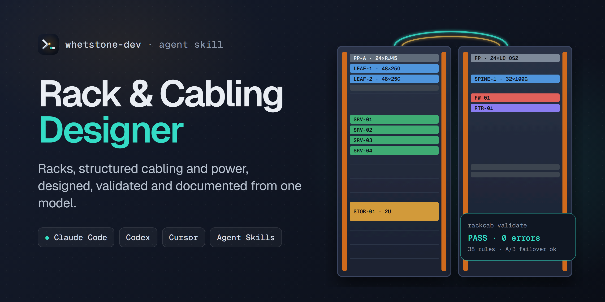
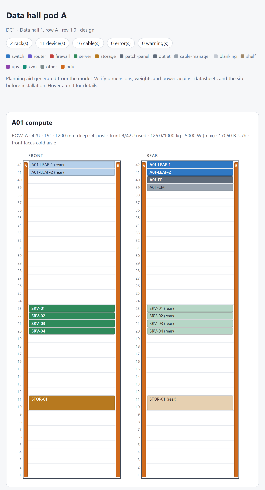
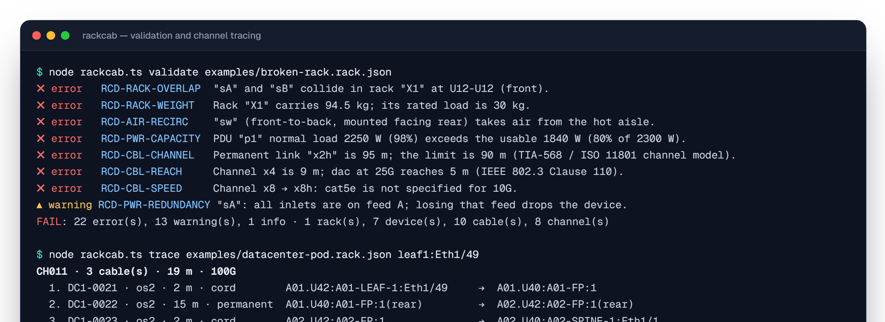
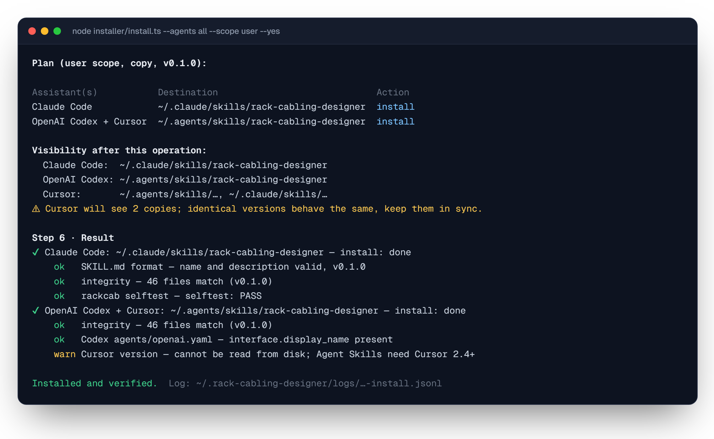
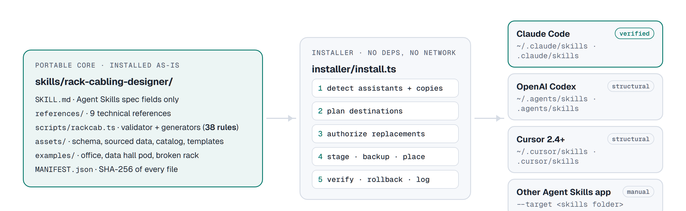

<p align="center">
  
</p>

<p align="center">
  <a href="https://github.com/whetstone-dev/rack-cabling-designer/actions/workflows/ci.yml"></a>
  <a href="CHANGELOG.md"></a>
  <a href="LICENSE"></a>
  
  
  <a href="https://agentskills.io"></a>
</p>

<p align="center">
  <a href="#quick-start">Quick start</a> ·
  <a href="#what-it-checks">What it checks</a> ·
  <a href="#outputs">Outputs</a> ·
  <a href="#installer">Installer</a> ·
  <a href="#compatibility">Compatibility</a> ·
  <a href="docs/">Docs</a>
</p>

---

**Rack & Cabling Designer** is an [Agent Skill](https://agentskills.io) that gives your AI coding assistant the know-how and the tools of an infrastructure designer. Describe a server room, a telecom closet or a data-hall row, and the assistant does the following:

1. It builds a structured **`*.rack.json` model**.
2. It **validates** the model against 38 rules covering rack fit, airflow, power redundancy, cabling reach and labeling.
3. It generates the deliverables an installer actually needs: **rack elevations, cable schedule, labels, bill of materials, power budget and as-built documentation**.

Everything comes from one model, so the drawings, the schedule and the BOM never contradict each other.

```text
"Design a 42U compute rack: four 1U servers with dual 25G, two leaf switches, a 2U storage
 array, A/B 32 A PDUs, OS2 uplinks to the network rack. Give me the elevation and the BOM."
```

## Highlights

| | |
|---|---|
| **One source of truth** | A JSON model with a JSON Schema (editor autocomplete). Every output is regenerated from it; nothing is edited by hand. |
| **Engineering checks, not just syntax** | It finds U collisions, oversized equipment, overloaded racks and hot-aisle intakes. It computes PDU load with derating and **the load if a feed fails**, and checks connector fit, port reuse, media vs. port type, **end-to-end channel reach** through patch panels, the 90 m + 10 m copper model, parallel-optics pitfalls and label rules. |
| **Sources, not guesses** | Every limit (reach per media and speed, derating, connector pairing) lives in a data file with its source (IEEE 802.3 clause, TIA/ISO standard), shown in each finding. |
| **Installer-ready deliverables** | Self-contained HTML elevations (front and rear, light and dark), CSV cable schedule and label sheet, BOM with transceivers and stock cord lengths, power budget, and a Markdown as-built document. |
| **Portable and safe** | Zero dependencies, no network, Node ≥ 22.18. Outputs escape every value (HTML, Markdown, CSV formula injection). |
| **One skill, several assistants** | A single spec-compliant core. The installer handles each platform's conventions and verifies the result. |

## See it

<table>
<tr>
<td width="46%" valign="top">

**Rack elevations**: front and rear views per rack, with PDUs on the side channels and full-depth equipment shown on both faces. The real output for [`examples/datacenter-pod.rack.json`](skills/rack-cabling-designer/examples/datacenter-pod.rack.json) is on the right.

Port-side-exhaust leaf switches mounted facing the rear, servers facing the cold aisle, and A/B 32 A PDUs. Validation passes with **0 errors, 0 warnings**. With either feed down, the remaining PDU carries 5.0 kW of its 5.9 kW usable capacity.

</td>
<td width="54%">
<picture>
  <source media="(prefers-color-scheme: dark)" srcset="docs/assets/elevation-dark.png">
  
</picture>
</td>
</tr>
</table>

**Findings that explain themselves.** Each one has a rule code, the numbers involved and the source of the limit. `trace` follows a link end to end through the patch panels:

<p align="center">
  
</p>

## Quick start

**1. Install** (Node.js ≥ 22.18; nothing else is downloaded):

```bash
git clone https://github.com/whetstone-dev/rack-cabling-designer.git
cd rack-cabling-designer
node installer/install.ts
```

The installer detects Claude Code, Codex and Cursor. It shows exactly where each copy will go, asks before replacing anything it did not install, then installs and verifies. See [Installer](#installer).

**2. Ask your assistant** in any language:

- *"I need a small office comms cabinet: 24U, one 48-port access switch, a router, a firewall and four desks."*
- *"Is it OK to run 10GBASE-T over 60 m of Cat6?"*
- *"Will PDU A survive if feed B fails?"*
- *"Validate `racks/hq.rack.json`, fix the errors and give me the cable schedule and labels."*

Or invoke the skill explicitly: `/rack-cabling-designer` in Claude Code or Cursor, `$rack-cabling-designer` in Codex.

**3. Or use the toolkit directly**, without an assistant:

```bash
TK=skills/rack-cabling-designer/scripts/rackcab.ts
node $TK init site.rack.json                   # starter model linked to the JSON Schema
node $TK validate site.rack.json --strict      # all rules; warnings also fail
node $TK build site.rack.json -o site-docs     # elevation.html, README.md, CSVs, power.md, report.json
node $TK trace site.rack.json leaf1:Eth1/49    # end-to-end channel through panels and outlets
```

## What it checks

| Family | Examples of what is caught | Rule codes |
|---|---|---|
| **Rack fit** | Out-of-bounds units; collisions (half-depth front and rear may share a unit, full-depth may not); equipment deeper than the rack; weight over the rated load; 2-post suitability | `RCD-RACK-*` |
| **Airflow** | Equipment taking air from the hot aisle (airflow direction + mounting face + aisle orientation); side-breathing gear; open units on the cold face | `RCD-AIR-*` |
| **Power** | Normal load over derated capacity; **load on the surviving PDU when a feed fails**; all PSUs on one feed; C20 inlets on C13 outlets; outlet reuse; missing power data | `RCD-PWR-*` |
| **Cabling** | Unknown or reused ports; media that the port cannot take; speed not specified for the media; **channel reach** across cords, panels and permanent links; permanent link > 90 m; cords > 10 m; mixed MM/SM; SR4 through LC-duplex panels | `RCD-CBL-*` |
| **Labels** | Missing or duplicate labels; label pattern; color code by cable function | `RCD-LBL-*` |
| **Model integrity** | Schema (typos caught as unknown fields), duplicate ids, broken references | `RCD-SCHEMA`, `RCD-REF`, `RCD-DUP-ID` |

Reach limits and electrical defaults are planning values taken from IEEE 802.3, ANSI/TIA-568, ISO/IEC 11801 and common practice; each value carries its source in [`assets/data/`](skills/rack-cabling-designer/assets/data). Confirm against the standard in force, the datasheets and your local electrical code (NEC, IEC 60364, RETIE…).

## Outputs

`rackcab build` writes:

| File | Content |
|---|---|
| `elevation.html` | Front/rear elevations for every rack, with findings. Self-contained: no scripts, no network, prints landscape |
| `README.md` | As-built or design document: summary, findings, U tables, power budget, channels, cable schedule, BOM, assumptions |
| `cable-schedule.csv` | Every cable grouped by end-to-end channel: A/B ends (rack.U:device:port), media, length, color, function, pathway |
| `labels.csv` | Two labels per cable (one per end), ready for a label printer |
| `bom.csv` | Equipment, PDUs, cords rounded to stock lengths, bulk cable with slack, transceivers by type, power cords, blanking panels |
| `power.md` | PDU capacity, usable capacity, normal and worst-failover load, rack heat in BTU/h |
| `report.json` | Machine-readable findings and channels |

## The model

```jsonc
{
  "modelVersion": 1,
  "meta": { "name": "Data hall pod A", "status": "design" },
  "policy": { "powerDerating": 0.8, "requireRedundantPower": true, "labelPattern": "^DC1-\\d{4}$" },
  "racks":   [{ "id": "A01", "heightU": 42, "depthMm": 1200, "maxLoadKg": 1000, "frontAisle": "cold" }],
  "devices": [{ "id": "srv01", "type": "generic-server-1u", "rack": "A01", "position": 23 }],
  "pdus":    [{ "id": "a01-pdu-a", "rack": "A01", "feed": "A", "voltage": 230, "maxAmps": 32,
               "outlets": [{ "connector": "C13", "count": 36 }] }],
  "powerLinks": [{ "device": "srv01", "inlet": "PSU1", "pdu": "a01-pdu-a", "outlet": 3 }],
  "cables":  [{ "id": "d01", "label": "DC1-0001", "media": "dac", "lengthM": 2,
               "a": { "device": "srv01", "port": "nic1" }, "b": { "device": "leaf1", "port": "Eth1/1" } }]
}
```

Generic equipment types (`generic-server-1u`, `generic-leaf-48-25g-6-100g`, `generic-patch-panel-24-rj45`…) let you start before datasheets exist; `rackcab catalog` lists them. Full specification: [`references/model.md`](skills/rack-cabling-designer/references/model.md).

## Installer

<p align="center">
  
</p>

The installer works through six steps:

1. **Assistants:** detected ones are pre-selected. Undetected ones can still be chosen after the installer explains what it cannot verify, and any other Agent Skills app can be targeted with `--target <skills folder>`.
2. **Scope:** user (every project) or project (one repository).
3. **Plan:** the destination per assistant, the action, and which assistant will see which copy. Duplicate copies are flagged.
4. **Authorization:** nothing it did not install is replaced without a per-destination "yes", and replaced copies are always backed up first.
5. **Review:** list every file and the exact operations before confirming.
6. **Result:** each copy is verified (SHA-256 against the manifest, format, Node version, self-test) and rolled back on failure. Every run is logged.

```bash
node installer/install.ts --agents claude-code,codex --scope user --yes   # non-interactive
node installer/install.ts --agents all --dry-run --show-files             # simulation, writes nothing
node installer/install.ts --update --yes                                  # update existing installs only
node installer/install.ts --verify                                        # read-only verification
node installer/install.ts --uninstall --agents codex --yes                # removes only files it installed
```

**Safety by design:**

- No network access.
- No shell commands.
- No administrator rights.
- The only process it starts is the toolkit self-test, and only on copies verified as its own.
- Uninstall never touches your projects or files you added.

Details: [docs/installer.md](docs/installer.md).

## Compatibility

The core is a standard [Agent Skills](https://agentskills.io/specification) folder (`SKILL.md` with the six spec fields only), so the same files serve every platform. Only the install location and activation differ. **A platform is listed as verified only when the real assistant was seen activating the skill**, not when files were copied.

| Assistant | Install location (user · project) | Structural | Toolkit from installed copy | Activation in the real assistant |
|---|---|:---:|:---:|---|
| **Claude Code** | `~/.claude/skills` · `.claude/skills` | ✅ | ✅ | ✅ **Verified.** CLI: discovery, implicit (`Skill` tool) and explicit `/rack-cabling-designer`, with a negative control. Desktop app: listed and invoked in a live session |
| **OpenAI Codex** | `~/.agents/skills` · `.agents/skills` | ✅ | ✅ | ⚠️ **Partial.** Discovery verified, and the skill was selected implicitly. Execution not yet confirmed (Windows sandbox bug [openai/codex#30024](https://github.com/openai/codex/issues/30024), account usage limit) |
| **Cursor 2.4+** | `~/.cursor/skills` · `.cursor/skills` | ✅ | ✅ | ⏳ **Not verified yet** |
| Other Agent Skills apps | `--target <skills folder>` | ✅ | ✅ | depends on the app |

Evidence for every cell: [docs/audit/2026-10-12-audit.md](docs/audit/2026-10-12-audit.md). Per-platform capabilities and known limitations: [docs/compatibility.md](docs/compatibility.md).

## Architecture

<picture>
  <source media="(prefers-color-scheme: dark)" srcset="docs/assets/architecture-dark.png">
  
</picture>

```text
skills/rack-cabling-designer/   the portable skill (the only thing installed)
├── SKILL.md                    instructions: workflow, task router, execution policy
├── references/                 racks · structured cabling · media · power · airflow · labeling · documentation · model · safety
├── scripts/rackcab.ts          CLI; scripts/lib/rules/ holds all 38 rules, scripts/lib/outputs/ the generators
├── assets/                     JSON Schema, sourced data, generic catalog, templates (site survey, change plan)
├── examples/                   small office · data hall pod · deliberately broken rack
└── agents/openai.yaml          Codex UI metadata (ignored elsewhere)
installer/                      detect · plan · execute · uninstall · verify · adapters (no domain logic)
tools/                          manifest builder · skill linter · compatibility audit
tests/                          adapters · installer · interactive · safety · scenarios · platform smoke
```

## Quality

```bash
npm test               # 68 automated tests (core rules, outputs, installer, adapters, safety, scenarios)
npm run lint:skill     # Agent Skills spec + Claude API rules + links
npm run audit          # installs into sandboxes for every platform × scope and runs the toolkit from each copy
npm run smoke -- --agent claude-code   # real assistant: control, discovery, implicit and explicit cases
```

CI runs the suite on Ubuntu, Windows and macOS with Node 22 and 24, plus the official `skills-ref` validator. See [docs/testing.md](docs/testing.md).

## Scope and limits

This is a **planning aid**. A passing validation means the model is consistent; it is not a site survey, a cabling certification or an electrical design. The skill does not calculate fiber insertion-loss budgets, bend radius, tray fill ratios, PoE heating, seismic bracing or fire-code requirements, and it says so instead of guessing. Electrical work must be designed and installed by qualified personnel. Generated documents can reveal site layouts and circuit references, so review them before sharing outside your organization. See [`references/safety.md`](skills/rack-cabling-designer/references/safety.md) and [SECURITY.md](SECURITY.md).

## Contributing

Issues and pull requests are welcome; read [CONTRIBUTING.md](CONTRIBUTING.md) first.

- Rules belong only in the core (`scripts/lib/rules/`).
- Normative values belong in `assets/data/`, together with their source.
- Platform conventions belong in `installer/adapters/`.

## License

[MIT](LICENSE) © Juan David ([Juanfrxz](https://github.com/Juanfrxz)) · part of **[whetstone-dev](https://github.com/whetstone-dev)**, an open-source lab building sharper agents.
